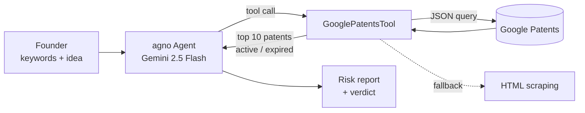

# Patent Search Agent

An AI agent that does a first freedom-to-operate check on a startup idea. You give it a few keywords and a short description. It searches Google Patents, looks at the closest patents, and gives a verdict on whether the idea is free to build, blocked, or in a grey area.

Built with [agno](https://github.com/agno-agi/agno) (an agent framework) and Google **Gemini 2.5 Flash**. The search itself is a custom tool the model calls.

## How it works



1. **Tool use.** The agent has to call `search_patents` before it answers, so its verdict is based on real search results and not on what the model remembers.
2. **Search.** `GooglePatentsTool` (an agno `Toolkit`) queries Google Patents for documents with a priority date in the last 20 years, the maximum life of a patent. If the JSON endpoint fails, it falls back to scraping the HTML page.
3. **Active or expired.** Each result is marked **active** if it was filed less than 20 years ago, so it may still block you, or **expired**, which makes it prior art you can build on.
4. **Report.** A system prompt written for IP analysis turns the results into a structured report.

## Example output

The agent writes its report in Italian with this structure (defined in `SYSTEM_PROMPT`):

```text
📋 Top 10 similar patents   ID · title · assignee · ACTIVE ⚠️ / EXPIRED ✅
⚖️  Risk per patent          high / medium / low, based on how close the claims are to your idea
🧭 Final verdict             🟢 IDEA FREE   🔴 IDEA BLOCKED   🟡 GREY AREA
📝 Why                       3–4 lines
💡 Next steps                how to set the idea apart, or other routes to take
```

The idea used in testing was a network of indoor plant sensors whose data goes to an AI that spots diseases early and alerts the owner (hardware, database, web app and AI agents).

## Run it

```bash
git clone https://github.com/RiccardoFalco06/AI-agent-for-patent-search-on-google-patents.git
cd AI-agent-for-patent-search-on-google-patents
python -m venv .venv && source .venv/bin/activate
pip install -r requirements.txt
cp .env.example .env        # add your Gemini API key (https://aistudio.google.com/apikey)
python Patents_Search.py
```

```text
============================================================
  🔍 PATENT SEARCH AGENT - powered by agno + Gemini
============================================================

>>> Keywords: indoor plant sensor AI disease detection
>>> Descrizione: sensors collect plant data, an AI detects illnesses early...
```

## Stack

| | |
|---|---|
| Agent framework | agno (`Agent`, `Toolkit`) |
| LLM | Gemini 2.5 Flash |
| Data | Google Patents (JSON query endpoint, HTML fallback) |
| Libraries | `requests`, `beautifulsoup4`, `python-dotenv` |

## Limitations

- Google Patents has no official public API, and Google often blocks automated requests. When that happens, the tool returns a link for a manual search instead of results. For a sturdier setup, use SerpAPI or the Google Patents public dataset on BigQuery.
- The active/expired check uses the 20-year rule only. It ignores maintenance fees and patent-term extensions.
- This is a technical first pass, **not legal advice**. The agent always tells you to confirm with an IP lawyer.
